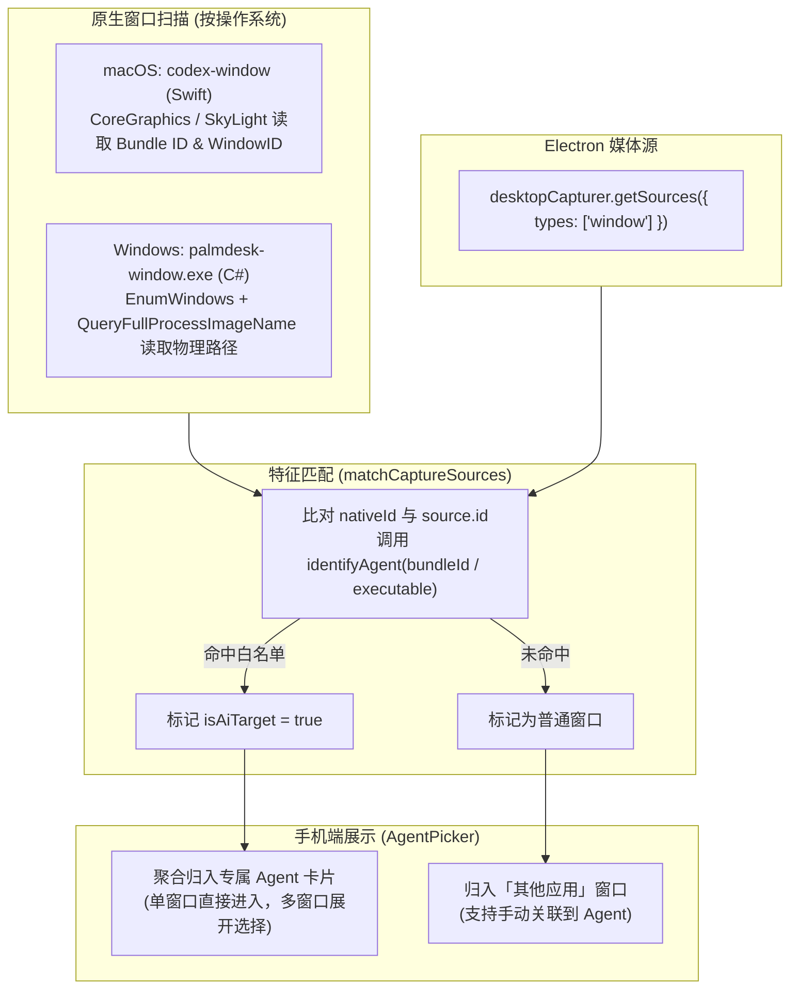

# PalmDesk Agent 探测与识别机制

本文档详细记录 PalmDesk 如何在 macOS 与 Windows 上自动检测、识别受支持的 AI Agent，包括 **GUI 运行窗口与安装状态检测** 以及 **本地历史会话日志检测** 两套独立体系。

---

## 1. 概述与设计原则

PalmDesk 的核心定位是 **AI-native remote control**（面向 Agent 就绪工作流）。为了让用户在移动端一目了然地找到 AI 工具，PalmDesk 实现了两层检测：
1. **GUI 层面**：自动识别电脑上已打开或已安装的 Agent 应用，聚合到移动端的「Agent 目录」供快速选窗或一键启动。
2. **会话层面**：在不需要开启窗口推流的情况下，后台只读扫描本地 Agent 的日志文件，在「会话阅读」页展示结构化 Markdown 回复与工具输出。

### 核心安全原则
- **零侵入**：不向目标 Agent 进程注入任何动态链接库（DLL / dylib），不挂钩系统钩子（API Hook），不读写目标进程内存。
- **纯只读**：只通过操作系统公开的窗口元数据（Bundle ID / 可执行文件路径）和磁盘上已持久化的只读日志工作，不主动执行 Agent CLI。
- **本地化**：所有探测与识别全部在宿主机本地执行，不向云端发送任何进程列表或未授权文件。

---

## 2. 维度一：GUI 桌面窗口与已安装 Agent 检测

### 2.1 核心特征库（[`agent-registry.ts`](file:///Volumes/ext/developments/zixun/palmdesk/src/utils/agent-registry.ts)）

PalmDesk 在前端与桌面端共用一套特征白名单：

| Agent | 官方/应用标识 (ID) | macOS Bundle ID | Windows 原生可执行文件名 |
| --- | --- | --- | --- |
| **Codex** | `codex` | `com.openai.codex` | `codex.exe` |
| **Claude (Desktop)** | `claude` | `com.anthropic.claudefordesktop` | `claude.exe` |
| **ChatGPT** | `chatgpt` | `com.openai.chat` | `chatgpt.exe` |
| **Kimi** | `kimi` | `com.moonshot.kimichat` | `kimi.exe`, `kimi desktop.exe`, `kimi work.exe`, `kimi-work.exe` |
| **ZCode** | `zcode` | `dev.zcode.app` | `zcode.exe` |

---

### 2.2 运行中窗口的检测与匹配链路

当手机端连接后拉取窗口列表时，宿主电脑执行以下匹配流程：



1. **macOS 原生扫描**：
   - 依赖编译的原生辅助进程 [`codex-window.swift`](file:///Volumes/ext/developments/zixun/palmdesk/electron-main/native/codex-window.swift)；
   - 调用 `CoreGraphics` 的 `CGWindowListCopyWindowInfo` 以及 SkyLight 私有接口，枚举当前用户会话中的所有应用窗口；
   - 提取每个窗口的 `nativeId`（`kCGWindowNumber`）、`ownerPid` 以及通过 `NSRunningApplication` 获取的 `CFBundleIdentifier`（Bundle ID）。
2. **Windows 原生扫描**：
   - 依赖编译的原生辅助程序 [`palmdesk-window.cs`](file:///Volumes/ext/developments/zixun/palmdesk/electron-main/native/palmdesk-window.cs)；
   - 调用 Win32 API `EnumWindows` 遍历窗口，通过 `QueryFullProcessImageName` 查询所属进程的完整可执行文件路径，并提取文件名与启动哈希。
3. **整合与打标**：
   - 在 [`native-window.ts`](file:///Volumes/ext/developments/zixun/palmdesk/electron-main/native-window.ts#L82) 的 `matchCaptureSources` 中，将原生窗口与 Electron 捕获源精准对齐；
   - 如果命中了特征库，赋予 `isAiTarget: true`，并在前端以高优先级置顶和分类显示。

---

### 2.3 未运行但已安装的 Agent 检测（“打开 Agent”功能）

如果电脑上装了某个 Agent 但尚未启动，移动端会展示“未运行”，并允许点击一键拉起。其安装状态探测机制见 [`agent-launcher.ts`](file:///Volumes/ext/developments/zixun/palmdesk/electron-main/agent-launcher.ts)：

- **macOS 实现**：
  在 Swift 中调用 Apple 官方的 Launch Services：
  ```swift
  NSWorkspace.shared.urlForApplication(withBundleIdentifier: identifier)
  ```
  直接向系统服务查询是否存在匹配 Bundle ID 且主可执行文件有效的应用，秒级返回结果，无需深度遍历磁盘。
- **Windows 实现**：
  通过后台执行优化过的 PowerShell 脚本进行注册表与包查询：
  1. 检索注册表 `App Paths`（包括 `HKCU` 与 `HKLM` 的 `Software\Microsoft\Windows\CurrentVersion\App Paths`）；
  2. 针对 Windows 商店 / MSIX 安装的现代包，调用 `Get-AppxPackage` 读取 `AppxManifest.xml`；
  3. 验证查找到的物理文件是否存在且具备可执行权限。

---

## 3. 维度二：本地会话日志检测（会话阅读层面）

会话阅读模块（由迁入自 Glassline 的 [`session-core`](file:///Volumes/ext/developments/zixun/palmdesk/session-core/index.mjs) 独立驱动）不依赖任何 GUI 窗口或屏幕录制权限，完全以**只读文件流**方式识别本机 Agent 的工作进展：

### 3.1 Codex 会话检测
- **默认目录**：检查环境变量 `CODEX_HOME`；缺省时 macOS/Linux 使用 `~/.codex`，Windows 使用 `%USERPROFILE%\.codex`。
- **内容识别**：读取其中的 SQLite 索引或 JSON 存储，流式抽取头尾各最多 64 KiB 摘要，获取标题、更新时间与最新对话轮次。

### 3.2 Claude Code (CLI) 会话检测
- **默认目录**：按照 Claude 官方设计，检查环境变量 `CLAUDE_CONFIG_DIR`；缺省时读取 `~/.claude/projects/*/*.jsonl`。
- **内容识别**：
  - 流式扫描每个项目的根会话 `.jsonl` 文件（单文件最大限制 32 MiB）；
  - 自动读取会话专属标题：按 `custom-title`（用户手动重命名）、`agent-name`、`ai-title` 及首条用户 Prompt 顺序降级确定；
  - 沿 `last-prompt.leafUuid` 构建父链，将 Bash 命令行调用映射为“命令”，其他工具输出结构化折叠，保留完整执行上下文。

### 3.3 Claude Desktop (Code) 会话检测
- **扫描路径**：
  - **macOS**：扫描 `~/Library/Application Support/Claude` 与 `Claude-3p`；
  - **Windows**：扫描 `%APPDATA%\Claude`、`%LOCALAPPDATA%\Claude-3p` 以及 MSIX 应用包缓存目录 `%LOCALAPPDATA%\Packages\Claude_pzs8sxrjxfjjc\LocalCache`；可通过 `CLAUDE_USER_DATA_DIR` 手动指定。
- **内容识别**：严格只过滤本地 Code 入口的专属会话日志，对共享日志自动去重，不读取网页版 Chat 和云端记录。

---

## 4. 总结

PalmDesk 的 Agent 探测机制兼具**精准度**与**安全性**：
- 在 **GUI 控制端**，通过系统原生的 Bundle ID / App Paths 进行“靶向选窗与一键拉起”；
- 在 **数据阅读端**，通过只读文件流直接读取本地日志并折叠复杂工具输出；
- 两者无缝配合，构成了 PalmDesk “先读日志看进度、必要时切入窗口干预”的 AI-native 完整闭环体验。
