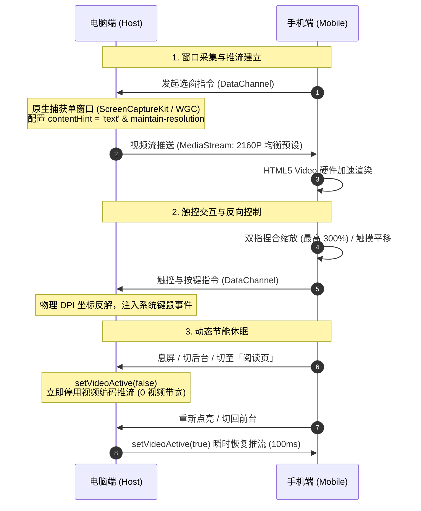
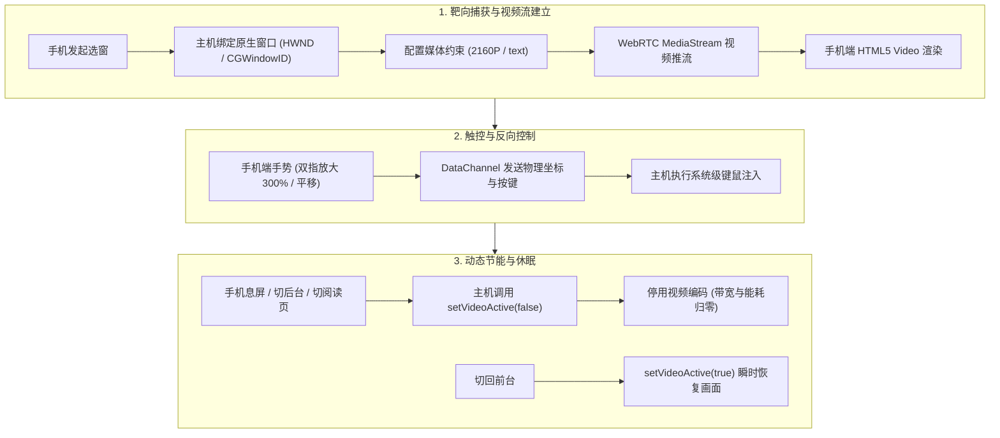
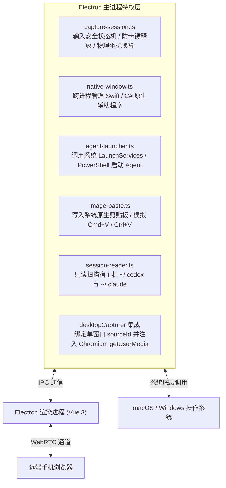
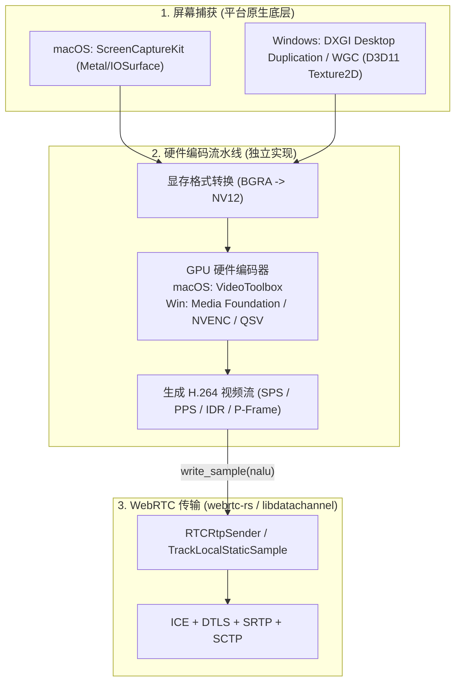

# PalmDesk 流模式（单窗口视频流与远程控制）实现方案

本文档详细记录 PalmDesk **流模式（单窗口视频流远程控制）** 的技术架构、端到端工作链路、关键实现机制、手势引擎以及节能休眠策略。

---

## 1. 概述与设计哲学

在 PalmDesk 中，**流模式（Stream Mode / 窗口控制模式）** 是与纯文本的“会话阅读模式”并列的核心引擎。

它的设计哲学是：**在手机等移动端浏览器上，以最低的延迟、最高的文字保真度（不模糊）且兼顾低发热，实现对电脑上单个 AI 应用窗口的音视频推流与反向操控。**

### 1.1 与 BilldDesk 的渊源与二次开发演进

PalmDesk 深度基于 [BilldDesk](https://github.com/galaxy-s10/billd-desk) 开源版本二次重构而来：
- **技术继承**：继承并优化了 BilldDesk 原有的 WebRTC P2P 穿透、信令服务与基础网络连接框架，保留 MIT 协议及上游署名；
- **重构与定制**：
  1. **迁入 `session-core` 引擎**：实现本地 Codex 与 Claude Code 会话日志的结构化解析，打造纯文本“会话阅读模式”；
  2. **引入原生系统级辅助程序**：编写 macOS Swift（ScreenCaptureKit）与 Windows C#（WGC）底层辅助工具，实现精准的单窗口硬件级抓取与坐标反解；
  3. **移动端交互重塑**：重构触控手势引擎，支持 300% 无级缩放平移、原生 Unicode 文本直接上屏，以及切后台 0 视频带宽动态休眠。

### 1.2 为什么不支持“整屏推流”，坚持做“单窗口”？

在技术底层，Electron 的 `desktopCapturer` 原生支持通过 `types: ['screen']` 捕获整块屏幕。然而，PalmDesk 在代码中显式限定了 `types: ['window']`，有意排除了整屏推流。这是基于实际 AI Agent 工作流体验的深思熟虑：

1. **隐私与敏感数据隔离（Privacy Isolation）**：
   - 开发者通常在手机、平板或移动场景下临时跟进任务。整屏推流会导致电脑上弹出的微信消息、私人邮件、未关闭的浏览器标签页或桌面隐私文件全盘暴露；
   - **单窗口模式下，远端只能看到你选中的那个 IDE 或终端窗口**，电脑上的其他工作区和个人应用完全隐形。
2. **移动端可读性与操作精度（Mobile Readability）**：
   - 现代开发机普遍采用 2K/4K 乃至多显示器拼接。如果整屏推流，画面压缩至手机小屏后字小如蚂蚁，极难辨识；
   - 单窗口推流能让目标窗口（如 1080P/2160P 的终端）按原始长宽比充满手机视口，配合 **300% 双指放大**，小字代码也能清晰阅读和精准触控。
3. **macOS 跨虚拟桌面（Spaces）自动穿透唤醒**：
   - 传统全屏远控只能捕获当前活动的虚拟桌面。如果你的 Agent 运行在后台或“桌面 2”，全屏推流无法直接看见；
   - PalmDesk 单窗口引擎结合 SkyLight 与 AX 辅助接口，**无论目标窗口隐藏在哪个虚拟桌面，都能一键激活并靶向捕获**，且不干扰当前显示器的其他桌面。
4. **AI-Native 工作流收敛（Workflow Alignment）**：
   - 市面上已有成熟的通用全屏运维软件（如向日葵、TeamViewer）。PalmDesk 并不打算做通用的桌面运维工具，而是聚焦于 `发现 Agent ➡️ 阅读进度 ➡️ 一键切入窗口输入确认 ➡️ 息屏休眠` 的专有极简工作流。单窗口模式去除了所有无关桌面杂质，让交互体验高度聚焦。

### 1.3 与传统远程桌面的设计差异

| 对比维度 | 传统远程桌面（TeamViewer / 向日葵） | PalmDesk 流模式 |
| --- | --- | --- |
| **捕获范围** | 全屏桌面（包含任务栏与其它隐私窗口） | **仅单个指定应用窗口（隐私隔离）** |
| **弱网策略** | 降分辨率保流畅（代码变马赛克） | **`maintain-resolution`（降帧率保清晰，字绝不糊）** |
| **移动端缩放** | 整体屏幕压缩，看小字极吃力 | **双指无级放大至 300% + 平移** |
| **后台与待机** | 只要连接就全程推视频流，发烫耗电 | **息屏或切阅读模式自动休眠推流（0 视频带宽）** |
| **跨桌面能力** | 仅显示当前活动桌面 | **自动穿透 macOS 多个虚拟桌面（Spaces）** |

---

## 2. 端到端完整流转时序

### 2.1 交互时序图（简化双端交互）



### 2.2 状态流转图



---

## 3. 核心环节技术实现

### 3.1 原生单窗口靶向捕获（Host 端）

传统远程工具通常全屏抓取，PalmDesk 仅捕获用户选定的单一窗口：

- **macOS 底层实现**：
  利用 Apple 的 **ScreenCaptureKit** 框架（代码见 [`codex-window.swift`](file:///Volumes/ext/developments/zixun/palmdesk/electron-main/native/codex-window.swift)），按进程 PID 和原生 `kCGWindowNumber` 进行硬件级隔离捕获。通过 SkyLight 私有接口，即使用户在 Mac 上打开了其他桌面（Spaces）或最小化，也能跨桌面激活并捕获。
- **Windows 底层实现**：
  调用 Windows 10/11 的 **Windows Graphics Capture (WGC)**（代码见 [`palmdesk-window.cs`](file:///Volumes/ext/developments/zixun/palmdesk/electron-main/native/palmdesk-window.cs)），通过 `GraphicsCaptureSession` 按 HWND 单独捕获，不包含任务栏与桌面背景。
- **采集约束注入**：
  在 [`src/utils/remote-video.ts`](file:///Volumes/ext/developments/zixun/palmdesk/src/utils/remote-video.ts) 中，通过扩展约束将选定窗口送入采集管道：
  ```ts
  navigator.mediaDevices.getUserMedia({
    audio: false,
    video: {
      mandatory: {
        chromeMediaSource: 'desktop',
        chromeMediaSourceId: sourceId, // 宿主主进程审批的安全 WindowID
        maxWidth: 3840,
        maxHeight: 2160,
        maxFrameRate: 120
      }
    }
  });
  ```

---

### 3.2 面向代码与文字的“防模糊”WebRTC 编码策略

针对开发和 Agent 场景，文字可读性远重于瞬时帧率：

- **内容提示与降级策略（Text Content Hint）**：
  在 [`src/utils/network/webRTC.ts`](file:///Volumes/ext/developments/zixun/palmdesk/src/utils/network/webRTC.ts#L219-L228) 中，视频轨强制标记为：
  ```ts
  track.contentHint = 'text'; // 告知 WebRTC 编码器这是文字内容
  parameters.degradationPreference = 'maintain-resolution'; // 弱网降级策略：必须保分辨率！
  ```
  **效果**：当网络出现抖动或带宽受限时，编码器**只会降低传输帧率（如从 20fps 降到 8fps），而绝对不降低画面分辨率**，确保小字代码与终端文字始终清晰可见。

- **三档预设策略（Profile Ceilings）**：
  详见 [`docs/VIDEO_QUALITY.md`](file:///Volumes/ext/developments/zixun/palmdesk/docs/VIDEO_QUALITY.md)：
  | 预设模式 | 分辨率上限 | 帧率上限 | 码率上限 (Bitrate) | 适用场景 |
  | --- | --- | --- | --- | --- |
  | **均衡（默认）** | **3840×2160** | **20 fps** | **3000 kbit/s** | Retina 级文字细节，省流省电平衡 |
  | **高细节** | 3840×2160 | 30 fps | 8000 kbit/s | 追求极致刷新与流畅度 |
  | **省流量** | 1920×1080 | 10 fps | 1000 kbit/s | 弱网蜂窝数据环境 |

- **无缝动态热调整**：
  手机端切换画质时，无需断开 WebRTC 重建 SDP 协商，而是通过 `sender.getParameters()` / `sender.setParameters()` 动态无缝重设编码器的 `maxBitrate` 和 `maxFramerate`。

---

### 3.3 移动端视口手势引擎（Client 端：[`RemoteViewport`](file:///Volumes/ext/developments/zixun/palmdesk/src/components/RemoteViewport)）

手机屏幕尺寸有限，为实现对 4K 电脑窗口的高效查看与操作，前端实现了多指触控状态机：

- **手势判定与无级缩放**：
  - **双指捏合（Pinch-to-zoom）**：支持从 **100%（适合屏幕）连续平滑缩放到 300%**。放大后双指拖拽即可平移画面，方便在手机上把终端或 IDE 的某几行小字放大检视。
  - **单指触控模式映射**：
    - 单击：左键点击；
    - 长按（500ms）：触发右击上下文菜单；
    - 快速双击：触发双击选词；
    - 单指拖拽：在控制模式下作为鼠标拖选，在“平移模式”下作为画面拖动。
- **物理坐标反解**：
  移动端根据当前 CSS 缩放比例（Zoom Ratio）、平移偏移量（Pan Offset）以及宿主窗口的物理 DPI 像素，通过 WebRTC DataChannel 向主机发送归一化的物理坐标，消除高分屏缩放偏差。

---

### 3.4 智能休眠与极低功耗控制（Lifecycle）

在手机端常驻远程桌面容易导致设备发热与流量耗尽。PalmDesk 设计了深度休眠机制：

- **切后台 / 息屏感知**：
  通过浏览器的 `Page Visibility API` 和在线感知检测（[`remote-presence.ts`](file:///Volumes/ext/developments/zixun/palmdesk/src/utils/remote-presence.ts)），当手机锁屏、切换至其他 App 或切到「阅读」页时，前端发送休眠信令。
- **底层暂停视频编码（`setVideoActive(false)`）**：
  电脑端接收到通知后，设置 `sender.getParameters().encodings[0].active = false`。
  - **效果**：电脑端立即停止视频编码推流，**带宽直接降为 0，电脑 GPU/CPU 占用骤降，手机也不会在后台发热耗电**。
- **瞬时恢复**：
  当用户重新点亮手机或切回浏览器，电脑端调用 `setVideoActive(true)`，100ms 内瞬间恢复画面推流，无需经历漫长的 P2P 重新握手过程。

---

### 3.5 宿主特权层与 Electron 核心模块架构

在标准 Web 浏览器沙盒下，页面严禁直接截取后台任意应用或注入全局键鼠。PalmDesk 的 **Electron 主进程（`electron-main/`）** 作为特权宿主，协调以下核心模块支撑流模式与 Agent 远控：



#### 关键模块职责：
- [`capture-session.ts`](file:///Volumes/ext/developments/zixun/palmdesk/electron-main/capture-session.ts)：输入安全状态机，在每次按键注入前动态校验前台焦点，并在断网/关闭时自动向操作系统发送 `keyup` 释放所有按键；
- [`native-window.ts`](file:///Volumes/ext/developments/zixun/palmdesk/electron-main/native-window.ts)：跨进程高频调度 Swift / C# 辅助程序，处理窗口物理边界、缩略图生成与跨桌面 Spaces 激活；
- [`agent-launcher.ts`](file:///Volumes/ext/developments/zixun/palmdesk/electron-main/agent-launcher.ts)：安全启动本地 Agent 进程；
- [`image-paste.ts`](file:///Volumes/ext/developments/zixun/palmdesk/electron-main/image-paste.ts)：将移动端发来的图像二进制写入系统剪贴板，向当前焦点窗口定向模拟粘贴；
- [`session-reader.ts`](file:///Volumes/ext/developments/zixun/palmdesk/electron-main/session-reader.ts)：受控只读扫描本地日志，支持电脑端一键强制撤回权限；
- [`index.ts`](file:///Volumes/ext/developments/zixun/palmdesk/electron-main/index.ts)：Electron 生命周期主入口，集成 `desktopCapturer` 与系统休眠监听（`powerMonitor`）。

---

## 4. 媒体管线深度剖析：Chromium 方案与 Rust 独立重构评估

在评估流模式的技术底座时，一个核心议题是：**为什么当前采用 Electron / Chromium 原生媒体能力？如果使用 Rust 完全脱离 Chromium 自研重构，需要独立实现什么？市面上有哪些成熟实践？**

### 4.1 为什么 Chromium 将 WebRTC 与编解码深度绑定？

在标准 Web 开发中，调用 `navigator.mediaDevices.getUserMedia` 获取 `MediaStreamTrack` 后，通过 `peerConnection.addTrack(track)` 即可实现推流，开发者完全触碰不到底层的显存指针（DirectX/Metal Texture）或编码器寄存器配置。这是因为 Chromium 在底层做了高度集成的闭环设计：

1. **W3C 浏览器沙箱与安全隔离**：
   - 浏览器运行的是不可信的 Web/JS 代码，操作系统严格禁止网页脚本直接读取物理显存地址或直接操作底层 GPU 驱动；
   - W3C 标准设计了高度抽象的 `MediaStreamTrack` 规范，Chromium 在底层受信任的 C++ 媒体进程中打通了「屏幕抓取 ➔ 显存格式转换（如 BGRA 到 NV12） ➔ 硬件编码器调用（VideoToolbox / MediaFoundation / NVENC）」全流程，向上暴露不透明的媒体句柄。

2. **网络拥塞控制（BWE/GCC）与硬件编码器的毫秒级动态闭环**：
   - 实时音视频流畅低延迟的关键在于**传输层与编码器的极速联动**：
     - **RTCP PLI（Picture Loss Indication）**：移动端解码丢帧时，立即向发送端请求关键帧。Chromium 内核会直接指示硬件编码器强制刷出 IDR 关键帧（Force IDR）；
     - **TWCC / REMB 带宽自适应**：网络拥塞算法（Google Congestion Control）实时估算瓶颈带宽，Chromium 毫秒级动态下调或上浮编码器输出码率（Bitrate）与量化参数（QP）。
   - Chromium 内部嵌入的 Google `libwebrtc` 将 `webrtc::VideoEncoder` 与拥塞控制引擎在 C++ 层高度耦合并默认调校。如果脱离 Chromium，上层应用必须手工编写整套闭环。

---

### 4.2 独立对接 WebRTC（如 Rust / C++）的分离架构

如果使用系统级语言（如 Rust 的 `webrtc-rs`、C++ 的 `libdatachannel` 或 Go 的 `pion`）独立开发推流端，**这些开源 WebRTC 库本质上都是纯网络传输协议栈**（仅负责 SDP 协商、ICE 穿透、DTLS 握手、SRTP 加密和 SCTP 数据通道）。

它们**不包含**任何屏幕抓取能力，也**不包含**任何视频硬件编解码器。它们的接口标准高度纯粹：
> **“调用者负责提供压缩好的视频数据包（H.264/H.265/VP9 NALU），传输栈负责打包为 RTP 并通过 SRTP 发送给远端。”**

因此，独立重构方案必须分层搭建完整的原生媒体管线：



独立管线必须独立攻克 4 个核心环节：
1. **显存零拷贝采集**：抓屏必须停留在 GPU 显存（macOS 的 `IOSurface`，Windows 的 `ID3D11Texture2D`），严禁回读到 CPU 内存（4K/60FPS 内存拷贝会直接占满总线并引起掉帧）；
2. **底层硬件低延迟编码**：调用操作系统显卡驱动接口，强制开启零延迟配置（Zero-latency、关闭 B 帧、恒定比特率 CBR / 极低延迟 VBR）；
3. **NALU 格式封装与送流**：将编码器输出的 Annex-B / AVCC 字节封装为 WebRTC 的 `Sample`，注入 `RTCRtpSender`；
4. **RTCP 动态反馈驱动**：独立监听底层 WebRTC 触发的 RTCP 数据包：收到 PLI 请求时立即指示编码器插入 IDR 关键帧；收到带宽估计变化时动态重设编码器码率。

---

### 4.3 市面上成熟的 Rust 编解码与流媒体案例

在工业界和开源社区中，**几乎没有人会用纯 CPU 软件算法从零编写 H.264 编码器**（性能无法支撑 4K 实时推流）。主流实践均采用 **“Rust 作为调度核心与显存管理者，直接驱动系统底层硬件编码器或复用工业级成熟组件”**：

#### 1. 最直接工业级标杆：RustDesk 的 `hwcodec`
- **[RustDesk](https://github.com/rustdesk/rustdesk)**（80k+ stars 开源远程桌面）在多轮迭代后，将其低延迟硬件编解码管线独立抽离为了开源 Rust Crate：**`hwcodec`**。
- **底层覆盖**：
  - Windows：支持 NVIDIA NVENC、Intel QSV、AMD AMF 以及 DirectX Media Foundation；
  - macOS：封装 Apple VideoToolbox；
  - Linux：对接 VA-API。
- **专为远控场景设计**：默认关闭 B 帧、支持无缝动态变码率和关键帧强制注入（Force IDR），并提供 `ffmpeg-next` 作为老旧设备软件兜底。
- **参考价值**：若 PalmDesk 进行 Rust 核心重构，RustDesk 的底层编解码设计与抓屏实现（`scrap`）是最直接可参照复用的工程蓝本。

#### 2. 工业级多媒体流水线：`gst-plugins-rs` (GStreamer Rust)
- 由 GStreamer 官方团队与 Collabora / Red Hat 联合维护，是目前 Rust 领域工程度最高、生态最完备的媒体处理方案；
- 采用 100% 内存安全 Rust 编写插件，无缝集成系统硬件编解码驱动（NVCODEC、VA-API、VideoToolbox）并内置成熟的 `gstwebrtc` 模块，被广泛应用于 Linux 桌面（GNOME）及商用广播流媒体系统。

#### 3. 纯 Rust 编码器标杆（纯软编）
- **`rav1e`**（Xiph.Org / Mozilla）：100% 纯 Rust 编写的 AV1 视频编码器，内嵌大量手写 SIMD（AVX2 / Neon）加速，代表了纯 Rust 算法性能的上限（计算复杂度较高，适合高质量点播或录屏，实时低延迟推流 CPU 负荷较大）；
- **`openh264-rs`**：Cisco OpenH264 的轻量 Rust 绑定，静态编译打包无需外部依赖，体积仅数兆，常用作 WebRTC 无显卡环境下的纯 CPU 兜底软编。

#### 4. Rust 抓屏与传输配套生态
- **`xcap`**：目前最活跃的跨平台抓屏库（macOS 基于 ScreenCaptureKit，Windows 基于 Desktop Duplication）；
- **`windows-capture`**：专为 Windows 打造的超高性能抓屏库（基于 Windows.Graphics.Capture），直接输出 D3D11 纹理，支持 60~120FPS 显存零拷贝；
- **`webrtc-rs`**：纯 Rust 实现的 WebRTC 传输栈（Pion 架构移植版），轻量且易于嵌入无图形界面的系统 Daemon。

---

### 4.4 方案对比与 PalmDesk 演进结论

| 评估维度 | 当前方案：Electron + Chromium 媒体栈 | 未来探索：Rust + 原生硬件编码管线 |
| :--- | :--- | :--- |
| **开发与维护成本** | **极低**（标准 JS API，百行胶水代码打通采集与推流） | **极高**（需手工管理各 OS 显存纹理、编码器驱动与 RTCP 闭环） |
| **安装包体积** | 较重（包含 Chromium Runtime，100MB+） | **极轻**（独立二进制仅约 15MB ~ 30MB） |
| **常驻内存与能耗** | 约 200MB ~ 350MB | **极低**（约 30MB ~ 60MB） |
| **编解码白盒掌控力** | 黑盒（参数调节受限于 Chromium 开放配置） | **完全白盒**（QP、GOP、显存格式、超低延迟参数任意调校） |
| **现阶段定位适配** | **高度契合**（AI Agent 场景重在会话阅读、单窗口文本清晰度与快速交付） | **长期架构储备**（未来探索极轻量无界面 Daemon 守护进程时采用） |

---

## 5. 常见问题排查与无人值守 Windows（RDP 断开 / 无显示器）适配指南

在流模式运行过程中，部分特殊网络或硬件环境下可能会遇到“窗口视频已结束”等中断提示。本节汇总该问题的根本触发机制、日志定位方法，以及关闭 RDP 后、开机无人登录时、无物理显示器时让 PalmDesk 持续可用的配置方案。

### 5.1 核心报错剖析：“窗口视频已结束”的触发机制

在 PalmDesk 代码实现中（[`src/views/remote/index.vue`](file:///Volumes/ext/developments/zixun/palmdesk/src/views/remote/index.vue#L1447-L1456)）：
```ts
stream.getVideoTracks().forEach((track) =>
  track.addEventListener(
    'ended',
    () => {
      if (captureSessionId.value !== sessionId) return;
      endCaptureWithError('窗口视频已结束');
    },
    { once: true }
  )
);
```
此错误**并非服务端或网络通信报错**，而是**宿主操作系统（OS）或底层的 Chromium 抓屏设备主动切断了视频流**，导致 `MediaStreamTrack` 抛出 `ended` 事件。

#### 常见触发根因：
1. **被控窗口被点击了“最小化”（最常见 ⚠️）**：
   - Windows DWM（桌面窗口管理器）的机制是：一旦窗口被最小化到任务栏，操作系统会立刻回收该窗口的 GPU 显存缓冲区，停止画面渲染。Chromium 发现纹理消失，判定窗口失效并触发 `track.ended`。
   - **规则**：目标窗口可以被其他窗口遮挡在底层，但**绝对不能最小化**。
2. **PalmDesk 所在的用户会话处于“已断开（Disc）”状态（云主机和远程维护的主机最常见 ⚠️）**：
   - Windows 只为**挂在显示输出上的会话**渲染窗口：要么是本地物理控制台（`console`），要么是正在连接的 RDP 会话。
   - 点击 RDP 顶部的 `X` 关闭远程桌面后，会话不会注销，而是变成 `Disc`。此时会话没有任何显示输出，DWM 停止合成，PalmDesk 虽然仍在运行，但一开始捕获就会触发 `track.ended`。
   - **安装虚拟显示器（如 Virtual-Display-Driver）不能解决这个问题**：虚拟显示器挂在 `console` 上，不属于已断开的会话。必须把会话交回 `console`，见 [5.3](#53-无人值守-windows-防中断适配方案)。
   - **配置开机自动登录后的典型陷阱**：自动登录本来会让会话挂在 `console` 上；但 Windows 10/11 专业版只允许一个交互会话，开机后若用 RDP 连进去“检查一下”，会话会从 `console` 被挪到 RDP，关掉 RDP 后又变成 `Disc`，而 `console` 回到无人登录的登录界面。
   - 将 RDP 窗口**最小化**也会让远端停止刷新画面（见方案 D）。
3. **UAC 管理员提权或系统锁屏**：
   - Windows 弹出深黑色安全桌面（UAC 提权）或发生系统锁屏时，出于安全防护，操作系统会切断所有窗口捕获管道。

---

### 5.2 全链路日志排查指引

遇到流中断或连接异常时，可通过以下多端日志进行分层定位：

#### 1. 服务端日志（47.238.243.40 / 部署机）
```bash
cd /opt/palmdesk

# 查看 Coturn 中继数据转发与分配记录（检查是否有流量过境或 Connection reset）
docker compose logs -f coturn

# 查看信令服务与设备会话日志（检查 Socket.IO 房间加入与鉴权）
docker compose logs -f backend

# 查看 Nginx 请求与 WebSocket 升级日志
tail -f /var/log/nginx/access.log
```

#### 2. 客户端控制台日志（Windows / macOS 桌面宿主机）
- **调出 DevTools 控制台**：
  - 点击客户端界面右上角控制台/代码图标，或直接按 **`Ctrl + Shift + I`**（macOS 为 `Cmd + Option + I` / `F12`）；
  - 切换到 **Console** 标签页，可查看：
    - WebRTC PeerConnection 状态机变化与 ICE Candidate 收集；
    - `desktopCapturer` 获取到的 Track 状态与分辨率；
    - `track.ended` 触发时的精确异常堆栈。
- **本地配置与数据目录**：
  - Windows：`%APPDATA%\PalmDesk\`（即 `C:\Users\<username>\AppData\Roaming\PalmDesk\`）
  - macOS：`~/Library/Application Support/PalmDesk/`

#### 3. Windows 会话状态（排查“窗口视频已结束”的第一步）
在宿主机的管理员 PowerShell 或 SSH 中执行：
```powershell
# PalmDesk 所在会话必须是 console + Active（或正在连接的 rdp-tcp#N + Active）
query session

# PalmDesk 进程运行在哪个会话
Get-Process PalmDesk, dwm | Select-Object ProcessName, Id, SessionId

# 开机以来的会话登录/断开/重连记录：21=登录 24=断开 25=重连，Address 为“本地”表示控制台
Get-WinEvent -LogName 'Microsoft-Windows-TerminalServices-LocalSessionManager/Operational' -MaxEvents 30 |
  Select-Object TimeCreated, Id, Message
```
| `query session` 中 PalmDesk 用户的状态 | 结论 |
| --- | --- |
| `console` + `Active` | 正常，可以无人值守捕获 |
| `rdp-tcp#N` + `Active` | 正常，但关闭 RDP 后会变成 `Disc` |
| 无会话名 + `Disc`，同时 `console` 为 `Conn`（无人登录） | 会话已断开，捕获必然失败，需按 [5.3](#53-无人值守-windows-防中断适配方案) 交回 `console` |
| 列表中没有该用户 | 未登录或已注销，PalmDesk 没有运行，需配置自动登录 |

---

### 5.3 无人值守 Windows 防中断适配方案

适用于云服务器（ECS）、机房主机，以及平时用 RDP 维护、离开后希望用手机继续通过 PalmDesk 操作的 Windows 电脑。

> [!TIP]
> 在新机器上部署时，可直接按 [Windows 无人值守主机部署手册](WINDOWS_UNATTENDED_HOST.md) 操作，并使用一键脚本 [`scripts/windows/setup-unattended-host.ps1`](../scripts/windows/setup-unattended-host.ps1) 完成下文方案 B、C 的全部配置。

**核心原则：PalmDesk 所在的用户会话必须一直挂在 `console` 上并保持解锁。** 下表汇总了各种场景：

| 场景 | 会话状态 | PalmDesk 能否捕获 | 对应方案 |
| --- | --- | --- | --- |
| 开机后无人登录 | 无用户会话 | 不能（PalmDesk 未启动） | 方案 B：自动登录 + 开机自启 |
| 自动登录后无人操作 | `console` + `Active` | 能 | — |
| RDP 连接中 | `rdp-tcp#N` + `Active` | 能 | — |
| 点 `X` 关闭 RDP 后 | `Disc` | **不能** | 方案 A（手动）或方案 B（自动交回 `console`） |
| RDP 中“注销” | 会话结束 | 不能（PalmDesk 随会话退出） | 不要注销 |
| RDP 中先锁屏（Win+L）再关闭 | 交回 `console` 后仍是锁屏 | 不能 | 不要锁屏，直接关闭 RDP |
| 本机没有物理显示器（云主机） | `console` 只有基础显示输出 | 能，但分辨率可能很低 | 方案 C：虚拟显示器 |

#### 方案 A：手动用 `tscon` 把会话交回控制台（免安装，适合偶尔使用）

在 RDP 会话内**以管理员身份运行**下面的脚本，代替点击 `X`。RDP 窗口会立即断开，会话会转到 `console` 并继续渲染：

```bat
@echo off
%windir%\system32\chcp 65001 >nul
echo 正在将桌面转入本地控制台，保持 PalmDesk 可用...
for /f "skip=1 tokens=3" %%s in ('query user %USERNAME%') do (
    %windir%\System32\tscon.exe %%s /dest:console
)
```

- 下次需要维护时照常用 mstsc 登录，Windows 会把同一个会话接回 RDP，窗口和应用都会保留。
- 缺点：每次离开都必须记得运行脚本；直接点 `X` 还是会进入 `Disc`。若要免手动操作，请使用方案 B。

#### 方案 B：自动登录 + 开机自启 + 断开后自动交回控制台（无人值守，推荐 ⭐）

三步配置完成后，重启机器或关闭 RDP 都不需要人工处理，手机随时可以连接。

**第 1 步：开启自动登录。** 在管理员 PowerShell 中执行（将用户名和密码换成实际值）：
```powershell
$p = 'HKLM:\SOFTWARE\Microsoft\Windows NT\CurrentVersion\Winlogon'
Set-ItemProperty $p AutoAdminLogon '1'
Set-ItemProperty $p DefaultUserName '<用户名>'
Set-ItemProperty $p DefaultPassword '<密码>'
Set-ItemProperty $p DefaultDomainName '.'
```
也可以使用微软 [Sysinternals Autologon](https://learn.microsoft.com/sysinternals/downloads/autologon)，它会把密码加密保存为 LSA Secret，不以明文写入注册表。

**第 2 步：开机自启 PalmDesk。** 按 `Win + R` 输入 `shell:startup`，把 PalmDesk 及常用 Agent 应用的快捷方式放进打开的文件夹。

**第 3 步：RDP 断开后自动交回控制台。** 第 1、2 步只能保证开机后会话挂在 `console` 上；一旦有人用 RDP 连入再关闭，会话仍会变成 `Disc`。下面的计划任务以 SYSTEM 身份运行，监听会话断开事件（Event ID 24），自动执行 `tscon`。在管理员 PowerShell 中执行：

```powershell
$dir = 'C:\ProgramData\PalmDesk'
New-Item -ItemType Directory -Force -Path $dir | Out-Null

$script = @'
# 把自动登录用户已断开的会话交回物理控制台，让 DWM 继续渲染，保证 PalmDesk 可以捕获。
$log = 'C:\ProgramData\PalmDesk\return-to-console.log'
function Log($m) { Add-Content -Path $log -Value ('{0:yyyy-MM-dd HH:mm:ss}  {1}' -f (Get-Date), $m) -Encoding UTF8 }
Start-Sleep -Seconds 3
$user = (Get-ItemProperty 'HKLM:\SOFTWARE\Microsoft\Windows NT\CurrentVersion\Winlogon').DefaultUserName
if (-not $user) { Log 'no DefaultUserName, skip'; exit 0 }
$rows = @()
foreach ($line in (query user 2>$null | Select-Object -Skip 1)) {
  if ($line -match '^\s*>?(\S+)\s+(?:(\S+)\s+)?(\d+)\s+(\S+)') {
    $rows += [pscustomobject]@{ User = $Matches[1]; Id = [int]$Matches[3]; State = $Matches[4] }
  }
}
Log ('sessions: ' + (($rows | ForEach-Object { "$($_.User)#$($_.Id)=$($_.State)" }) -join ', '))
if ($rows | Where-Object { $_.State -match '^(Active|运行中)$' }) { Log 'an active session exists, skip'; exit 0 }
$target = $rows | Where-Object { $_.User -ieq $user -and $_.State -match '^(Disc|断开)' } | Select-Object -First 1
if (-not $target) { Log "no disconnected session for $user, skip"; exit 0 }
& "$env:windir\System32\tscon.exe" $target.Id /dest:console 2>&1 | ForEach-Object { Log "tscon: $_" }
Log ("tscon $($target.Id) /dest:console exit=$LASTEXITCODE")
'@
Set-Content -Path "$dir\return-to-console.ps1" -Value $script -Encoding UTF8

schtasks /create /tn 'PalmDesk\ReturnToConsole' /ru SYSTEM /rl HIGHEST /sc onevent `
  /ec 'Microsoft-Windows-TerminalServices-LocalSessionManager/Operational' `
  /mo '*[System[(EventID=24)]]' `
  /tr 'powershell.exe -NoProfile -WindowStyle Hidden -ExecutionPolicy Bypass -File C:\ProgramData\PalmDesk\return-to-console.ps1' /f

# 立即执行一次，修复当前已断开的会话
schtasks /run /tn 'PalmDesk\ReturnToConsole'
```

脚本设计要点：
- **以 SYSTEM 运行**：从已断开的会话外部执行 `tscon` 需要 SYSTEM 权限，否则必须提供目标会话的密码。
- **等待 3 秒并检查是否有活动会话**：RDP 接管控制台时，控制台会话也会先触发一次“断开”（Address 为“本地”），紧接着触发“重连”。脚本发现已有 `Active` 会话就跳过，不会把正在使用的 RDP 用户踢下线。
- **只处理自动登录用户**（`DefaultUserName`），不影响其他账号。

验证与回滚：
```powershell
query session                                            # 关闭 RDP 约 3 秒后，用户应为 console + Active
Get-Content C:\ProgramData\PalmDesk\return-to-console.log # 每次触发的判断与 tscon 结果
schtasks /delete /tn 'PalmDesk\ReturnToConsole' /f        # 回滚
```

实测记录（Windows 11 专业版，已配置自动登录和 PalmDesk 自启）：

| 时间 | 事件 | 结果 |
| --- | --- | --- |
| 15:26:06 | 自动登录（LogonType 2，本地） | 会话 1 挂在 `console`，PalmDesk 启动 |
| 15:27:12 | 从另一台电脑 RDP 连入（Event 25 重连） | 会话 1 被挪到 RDP |
| 15:27:32 | 点 `X` 关闭 RDP（Event 24 断开） | 会话 1 变为 `Disc`，`console` 回到登录界面，手机选窗后立即提示“窗口视频已结束” |
| 15:30:58 | 安装并运行 `PalmDesk\ReturnToConsole` | 日志记录 `tscon 1 /dest:console exit=0`，会话 1 恢复为 `console` + `Active` |

注意事项：
- **物理安全**：会话挂在 `console` 且未锁屏，意味着接在这台机器上的显示器会直接显示已解锁的桌面。任何“无人值守时保持渲染”的方案都有这个代价；若机器所在位置可被他人接触，请关闭或拔掉显示器。
- **不要注销，也不要先锁屏再关闭 RDP**（见上表）。
- **关闭 RDP 的瞬间若手机正在串流**，约 3 秒的交接期内视频可能中断，重新连接即可。
- **电源设置**：确认交流电源下“睡眠”为“从不”（`powercfg /query SCHEME_CURRENT SUB_SLEEP STANDBYIDLE`）；睡眠会断开网络和信令。
- Windows Server 默认允许多个 RDP 会话，RDP 连入时可能新建会话而不是接管 `console` 上的会话；此时 PalmDesk 仍运行在 `console` 会话中，不受影响。

#### 方案 C：虚拟显示器（[Virtual-Display-Driver](https://github.com/VirtualDrivers/Virtual-Display-Driver)，解决“没有显示器/分辨率太低”）

**作用边界**：虚拟显示器为 `console` 提供一块常驻显示输出，适用于没插显示器的物理主机，或 `console` 只有低分辨率基础显示输出的云主机；也可以添加适合手机的分辨率。**它不能让已断开（`Disc`）的会话恢复渲染**，必须与方案 A/B 配合使用。

- 基于微软 IddCx 架构，优于老旧的闭源 `usbmmidd`。
- 安装要点：
  1. 从 [Releases](https://github.com/VirtualDrivers/Virtual-Display-Driver/releases) 下载安装包，按仓库说明安装驱动；
  2. 驱动从 `C:\VirtualDisplayDriver\vdd_settings.xml` 读取配置（分辨率、刷新率、显示器数量），**请确认该文件位于此路径**，放在“下载”等其他目录不会生效；
  3. 安装成功后，设备管理器的“显示适配器”中会出现 `Virtual Display Driver`，“监视器”中会出现 `Generic Monitor (VDD by MTT)`。
- **在 RDP 会话中看不到虚拟显示器是正常现象**：RDP 期间 Windows 只显示 RDP 的虚拟显示器，“设置 ➔ 显示”会提示“无法从远程会话更改显示器设置”。需要在会话交回 `console` 后（例如通过 PalmDesk 或物理键鼠）才能看到并调整虚拟显示器。
- Windows Server 若需让 RDS 会话使用硬件 GPU，可启用组策略：`计算机配置 ➔ 管理模板 ➔ Windows 组件 ➔ 远程桌面服务 ➔ 远程桌面会话主机 ➔ 远程会话环境 ➔ 为所有远程桌面服务会话使用硬件图形适配器`，然后执行 `gpupdate /force`。

#### 方案 D：本地 RDP 客户端注册表优化（仅针对“RDP 最小化后画面停止刷新”）

若希望把本地 mstsc 窗口最小化到任务栏时远端仍持续刷新，可在**发起连接的本地电脑**修改注册表：
- 路径：`HKEY_CURRENT_USER\Software\Microsoft\Terminal Server Client`
- 新建 DWORD (32 位) 值 `RemoteDesktop_SuppressWhenMinimized`，设为 `2`。
