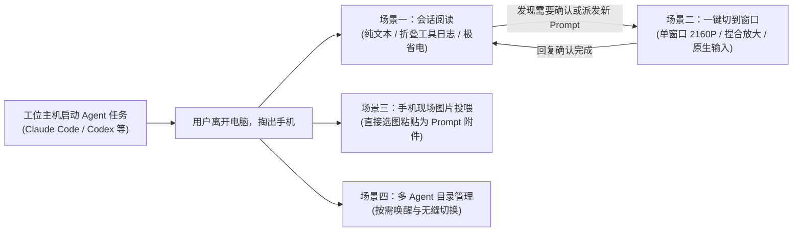
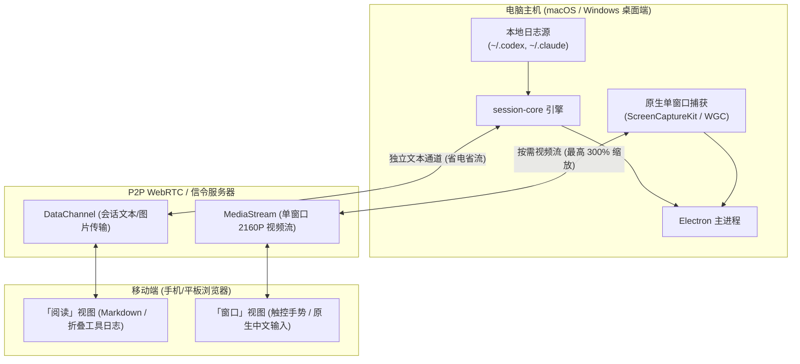
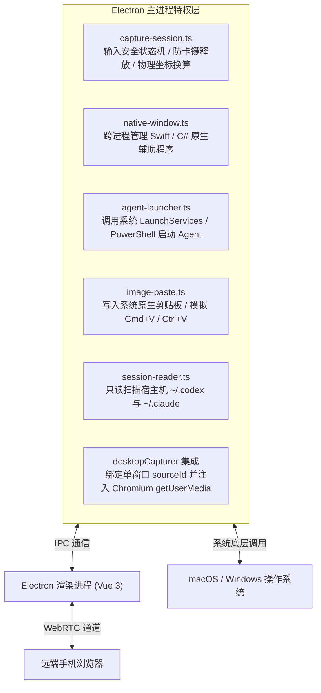

# PalmDesk 产品定位与使用场景

本文档详细阐述 PalmDesk 的产品定位、设计理念、典型使用场景、技术架构与功能边界。

---

## 1. 产品定位与设计理念

PalmDesk 的产品代号为 **Palm Window（掌中桌面）**，核心愿景是 **“desktop work, in your hand”**（让桌面工作尽在掌握）。

- **AI-native remote control（AI 原生远程控制）**：
  围绕用户使用 AI Agent 的实际链路进行专门设计与优化。它不仅是单纯的画面投屏，而是深度理解并接入 Agent 的运行形态（如结构化会话读取、状态轮询、工具调用折叠）。
- **面向 agent-ready workflows（面向 Agent 就绪工作流）**：
  着眼于帮助用户在多设备（特别是手机、平板与电脑）之间无缝连接与操作 Agent 工作流：发现 Agent 应用、阅读支持的本地会话、按需切入原窗口继续交互。

### 核心痛点与背景

在传统开发或长任务中，以 **Claude Code**、**Codex**、**Claude Desktop** 等为代表的命令行或 GUI Agent 常常需要执行数分钟乃至更长时间的自动化任务（如：重构项目、跑自动化测试、代码审计）。

开发者面临两大困扰：
1. **死守电脑工位**：无法在离开电脑桌（去开会、散步、就餐、卧床休息）时掌握 Agent 的最新进展。
2. **传统全屏远程桌面体验差**：
   - **画面负荷过重**：全屏推流带宽占用高、手机端发热严重、耗电飞快。
   - **文字阅读极度不便**：高分辨率桌面缩在手机小屏上，终端代码细小模糊，捏合缩放卡顿。
   - **缺乏会话语义**：传统远程软件把所有内容当成死板的像素，无法折叠庞大的构建日志与代码 Diff，亦无法对 Markdown 进行结构化阅读。
   - **输入容易冲突**：移动端软键盘与主机端输入法容易产生击键冲突或字符吞吐异常。

PalmDesk 通过 **“纯文本低功耗会话阅读” ➕ “按需极速单窗口远程控制”** 的两阶段工作流解决了这一问题。

---

## 2. 典型使用场景

### 场景一：离开工位，随时跟进长任务进展（文本会话阅读）
- **情景**：在电脑前给 Claude Code 或 Codex 派发了一个需要耗时 15–30 分钟的代码重构或排错任务，开发者离开工位。
- **操作流程**：
  1. 手机打开浏览器，扫描电脑端二维码或输入设备码即时认证（无需下载独立 App）。
  2. 手机端默认进入 **「会话阅读」** 视图。
  3. 系统自动读取本地会话日志（支持 Codex、Claude Code、Claude Desktop 本地 Code 会话），并按更新时间混合展示。
  4. 手机端以高可读性的 Markdown 呈现进展，庞大的 Bash 命令输出、工具调用结果（Tool Results）和代码 Diff 默认折叠，每 8 秒自动轮询新变化并提示跳转。
- **体验优势**：
  - 基于独立的 WebRTC DataChannel 文本通道传输，**无需启动主机屏幕录制与视频编码**；
  - 手机不发烫、不耗流量，待机能耗极低。

### 场景二：Agent 遇到卡点或等待输入，快速介入决策（单窗口控制）
- **情景**：在手机上浏览会话时，发现 Claude Code 停留在确认步骤（例如：“是否允许执行某 Shell 脚本？”），或 Codex 已完成上个阶段，正等待输入新 Prompt。
- **操作流程**：
  1. 点击手机界面上的 **「去窗口继续」**，直接切到视频流窗口。
  2. PalmDesk 自动定位并激活对应的目标应用窗口（即使它位于 macOS 的其他虚拟桌面 Spaces 或处于最小化状态）。
  3. 用户双指捏合自由放大（最高支持 300%），看清终端细节。
  4. 唤起手机端定制的中文输入框，输入文字后回车直接发送（原生 Unicode 传输，不与系统输入法冲突）。
  5. 确认完成后，切回「阅读」或直接将手机切到后台，电脑端会在数秒内自动暂停视频捕获，回归节能状态。

### 场景三：用手机给电脑里的 Agent 投喂图片（Codex 传图）
- **情景**：在手机上收到一份 UI 设计稿截图、遇到移动端真机报错，或者在白板上画了一张系统架构图，想要给主机上的 Codex 识别并编写代码。
- **操作流程**：
  1. 在手机连接页面中点击「选择图片」或直接长按粘贴系统剪贴板中的图片。
  2. 图片经由加密分块通道直传电脑端，主机端在校验窗口身份与焦点后，将图片解码写入系统剪贴板并执行粘贴快捷键（macOS `Cmd+V` / Windows `Ctrl+V`）。
  3. 图片直接挂载为 Codex 的 Prompt 附件，免去通过第三方聊天软件反复倒腾的琐碎流程。

### 场景四：多 Agent 窗口的发现与集中切换（Agent 目录）
- **情景**：电脑上同时运行着前端 Agent（Codex）、后端 Agent（Claude Code 终端）和多个普通工作窗口。
- **操作流程**：
  1. 在手机端打开 **「Agent 目录」**（[AgentPicker](file:///Volumes/ext/developments/zixun/palmdesk/src/components/AgentPicker)）。
  2. 系统通过 macOS bundle ID / Windows 可执行文件特征自动识别各主流 Agent，支持置顶和最近访问排序。
  3. 想要切到哪个任务，点击即可一键捕获该窗口，免去在全屏杂乱的桌面背景中逐一翻找。

---

## 3. 技术架构与工作方式

PalmDesk 整体采用 **Electron 桌面端宿主 + Vue 3 移动端网页控制端** 架构：

### 双通道工作链路说明

1. **会话读取通道（DataChannel）**：
   - 电脑端后台服务只读解析本地标准日志（`CODEX_HOME`、`~/.claude/projects/*/*.jsonl`）。
   - 结构化提取会话标题、Prompt、工具执行结果、Markdown 回复，以分片流式形式安全回传给手机。
   - 纯文字传输，待机极低功耗，不开启视频推流。
2. **单窗口捕获与控制通道（MediaStream + Input Channel）**：
   - 基于 macOS ScreenCaptureKit 与 Windows Graphics Capture，只捕获单一应用窗口，不涉及全屏与其它私人桌面内容。
   - 跨虚拟桌面唤醒与 DPI 物理坐标映射保障触控精度。
   - 移动端切后台或锁屏时，电脑端自动在数秒内暂停视频编码与推流；切回前台时自动快速恢复。

### 核心模块划分

| 模块 | 关键技术 | 职责说明 |
| --- | --- | --- |
| **会话解析核心** | [`session-core`](file:///Volumes/ext/developments/zixun/palmdesk/session-core/index.mjs) | 迁入自 Glassline 的轻量引擎，只读解析本地标准日志（`CODEX_HOME`、`~/.claude/projects/`、Claude Desktop 日志），负责流式摘要与分页。 |
| **会话数据通道** | [`session-reader-channel.ts`](file:///Volumes/ext/developments/zixun/palmdesk/src/utils/session-reader-channel.ts) | 建立独立的 WebRTC DataChannel，通过有界分片与背压控制在电脑与手机间传输结构化会话文本与图片附件。 |
| **单窗口原生捕获** | ScreenCaptureKit (macOS) / WGC (Windows) | 只捕获单一应用窗口，不涉及全屏幕与其他后台隐私；支持跨桌面（Spaces）自动激活。 |
| **移动控制视口** | [`RemoteViewport`](file:///Volumes/ext/developments/zixun/palmdesk/src/components/RemoteViewport) | 处理移动端触控手势（捏合平移、长按右键、双指缩放）、自适应码率切换与本地中文输入浮层。 |

### 3.3 Electron 宿主特权层架构与核心模块

在浏览器安全沙盒限制下，普通 Web 页面无法监控后台窗口或模拟全局键鼠。PalmDesk 的 **Electron 主进程（`electron-main/`）** 作为连接操作系统底层与 Web 视图的特权枢纽，组织了以下核心模块：

#### 核心特权模块职责：
- [`capture-session.ts`](file:///Volumes/ext/developments/zixun/palmdesk/electron-main/capture-session.ts)：输入安全状态机，负责前台焦点动态校验、物理 DPI 坐标转换与异常断线防卡键自动释放（Stuck Key Prevention）；
- [`native-window.ts`](file:///Volumes/ext/developments/zixun/palmdesk/electron-main/native-window.ts)：跨进程调度 Swift / C# 原生辅助程序，实现跨虚拟桌面（Spaces）唤醒与窗口缩略图补全；
- [`agent-launcher.ts`](file:///Volumes/ext/developments/zixun/palmdesk/electron-main/agent-launcher.ts)：调用系统 Launch Services / PowerShell 检索已安装的 Agent 并执行安全免路径注入拉起；
- [`image-paste.ts`](file:///Volumes/ext/developments/zixun/palmdesk/electron-main/image-paste.ts)：校验当前会话与 Codex 焦点，将手机上传的图片写入系统原生剪贴板并模拟 `Cmd+V` / `Ctrl+V`；
- [`session-reader.ts`](file:///Volumes/ext/developments/zixun/palmdesk/electron-main/session-reader.ts)：受控只读扫描本地会话文件，并提供物理开关随时强制撤回远端读取权限；
- [`index.ts`](file:///Volumes/ext/developments/zixun/palmdesk/electron-main/index.ts)：集成 `desktopCapturer` 与系统电源休眠监听（`powerMonitor`），负责全局生命周期与权限控制。

---

## 4. 产品边界说明（不是什么）

根据仓库协作规范（见 [AGENTS.md](file:///Volumes/ext/developments/zixun/palmdesk/AGENTS.md)），明确以下边界：
- **不内置与直跑大模型**：PalmDesk 不是聊天机器人，不包含大语言模型运行环境或云端模型 API 调用，它只对接本地已安装的 Agent。
- **不编排与代跑工作流**：PalmDesk 不自动代替用户向 Agent 调度任务或自动点击按钮。
- **不提供整屏全盘桌面运维**：PalmDesk 不是通用的全屏向日葵或 ToDesk，它有意收敛为单窗口靶向推流与会话阅读，保障隐私并最大化移动端代码可读性。
- **本质定位**：PalmDesk 是一座专为用户操作 Agent 量身定制的 **“掌中远程控制与阅读桥梁”**。
